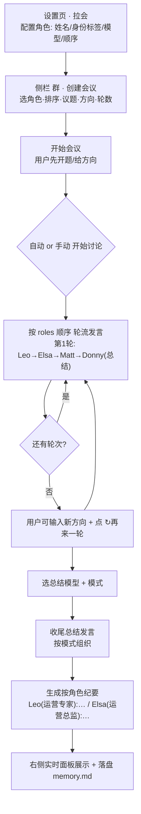

# 拉会（多角色 AI 会议）重设计 PRD

> 文档类型：简单 PRD（产品目标 + 用户故事 + 需求池 + UI 流程 + 待确认问题）
> 依据版本：alwith 0.3.6.2（Tauri 3 + React 19 + zustand + Vite）
> 文档状态：草案 v1（仅文档，未改动任何业务代码）
> 代码命名提示：本功能在代码内叫 **group / 拉会**（设置页"拉会"、侧栏"群"），UI 文案叫"会议/拉会"。下文统一称"会议"，涉及代码处标注 `group` 便于落地。

---

## 0. 现状分析（对齐代码，避免空中楼阁）

### 0.1 现有机制与关键文件

- **会议 = 一个 `GroupConfig`**（`src/lib/groups.ts`），存储于 `~/Documents/ALWith/groups/<会议名>/`，含 `group.md`（群说明文档）+ `memory.md`（历轮纪要）。
- **角色库（全局）**：`GroupRole` 接口（`src/lib/group-roles.ts`）：

  ```ts
  interface GroupRole {
    id: string
    name: string          // 角色名，如 "架构师"、"Leo"
    model: string         // 该角色发言所用模型
    effort: string | null
    fastMode?: boolean
    persona: { kind: "inline"; text: string } | { kind: "file"; path: string }
    skill: string | null
    moderator: boolean    // 是否为收尾总结人
  }
  ```

  **关键缺口**：没有独立的"身份标签"字段（如 运营专家 / 总监 / COO / CEO）。目前只有一个 `name` 和很长的 `persona` 指令文本，无法在发言/纪要里以"姓名（身份）"形式呈现。
- **角色配置入口**：**设置 → 拉会**（`src/features/settings/sections/group-section.tsx`）的"角色库"里增删改（含 名称 / 模型 / effort / 快模式 / persona 内联或文件 / 技能）。
- **发言顺序 = `GroupConfig.roles` 数组顺序**。`RosterEditor`（`src/features/groups/roster-editor.tsx`）支持拖拽排序，**最后一位自动带"总结人"徽标** → 即当前已支持"按固定顺序轮流、末位收尾总结"。
- **轮次**：`GroupConfig.rounds`（每场会议轮数；默认来自 `groupPreferences().rounds`）。`GroupPreferences`（`src/lib/group-preferences.ts`）仅含 `rounds`（默认 2，区间 1–5）与 `summaryTemplate`（自由文本，默认"结论/待办/说明"）。**没有"总结模式"枚举，也没有独立的"总结模型"字段。**
- **编排核心**：`src/features/groups/use-group-discussion.ts` 的 `runDiscussion()`：按 `roles` 顺序生成 `turns` → 调 `client.runGroupDiscussion(sessionId, turns, rounds, document, groupPreferences().summaryTemplate, { focus, materials })`。发言/总结的 prompt 在 `src/agent/group-turns.ts` 的 `groupTurnPrompt()`（speech / summary 两种 kind）。
- **纪要落盘**：`src/features/groups/group-memory.ts` `recordGroupRounds()` 追加到 `<dir>/memory.md`。**当前格式是"每轮一段"**：`## 第 N/M 轮 · 时间 · 主题` + `本轮结论与待办` + `发言（N 次）`（每位发言 `#### 时间 · 姓名 · 第k次发言`）。**不是用户要的"按角色汇总"格式。**
- **控制条**：`src/features/groups/group-bar.tsx`（位于输入区上方）。显示当前发言者、轮次进度（`第 cur/total 轮`）、成员 chips（末位标"总结人"）、focus 标签；运行中显示 暂停/继续 + 停止，空闲显示 开始讨论 / 再来一轮。**没有"跳过当前发言者"按钮。**
- **"再来一轮"**：`startGroupDiscussion(sessionId, 1)`（force=true）。控制条里已讨论过时点击 `run(1)`，即**只追加 1 轮**（`group-bar.tsx` 第 160 行 `run(discussed ? 1 : group.rounds)`）。**没有"改方向/给新指令"的输入框**——方向靠 `group.focus`（长期）与 `group.topic`（创建时设）驱动，中途改方向需重开对话框编辑，体验割裂。
- **模型切换"不生效"根因**：用户中途切模型（如 Opus 5.5 → 6.1 Sol）提示"新会话才会使用"来自 `src/agent/client.ts` 的 `withoutModelSwitchNotes`（通用会话模型切换提示），**与群无关**；群内每个角色有自己固定的 `model`，运行中切会话模型不影响群发言。即当前**没有"本次总结用哪个模型"的显式选择器**。
- **上下文压缩**：`group-turns.ts` 中 `MAX_DOCUMENT_CHARS = 6000`（群说明从前截）；`readDocument()` 用 `groupTailText` 仅携带 `memory.md` 最近 1200 字作为"历轮纪要"。长会议会丢掉早期上下文，质量下降。
- **没有实时右侧会议纪要面板组件**：当前纪要仅写入 `memory.md`（best-effort）。用户截图里的"右侧实时会议纪要面板"在当前代码里不存在（或已与对话流脱节）——需新建可联动、可高亮的实时面板（见 P1）。

### 0.2 现状结论

- 顺序发言、末位总结、再来一轮 **已经具备骨架**。用户"聊的乱七八糟"主要源于：
  1. 角色无身份标签、发言混入用户消息/长文/文件操作记录，身份难辨；
  2. 没有"改方向"入口、模型选择对当前会议不透明；
  3. 纪要按"轮"而非"角色"组织、且无可联动的实时面板；
  4. 轮次控制与单步控制（暂停/停止）在同一窄条，易混淆。
- 重设计应**复用已有骨架**（`roles` 顺序、moderator 末位、rounds、`memory.md` 落盘），补齐：身份标签、显式总结模型/模式、改方向输入、按角色纪要 + 实时面板、控制条分层。

---

## 1. 产品目标

把"拉会"从"多人模型在一段对话里各说各话"重设计为 **有序、可控、可追溯的多角色 AI 会议**：角色按设定顺序轮流发言、身份清晰可辨；用户可中途改方向并追加轮次；所有轮次结束后由用户指定模型、按设定模式产出"按角色"的会议纪要，并实时联动展示。

---

## 2. 用户故事

- 作为运营负责人，我希望在 **设置页为每位角色配置身份标签（如 运营专家 / COO）和发言顺序**，这样会议里每个观点都能被准确归到"谁（什么身份）"，而不是一堆混在一起的长文。
- 作为参会者，我希望会议 **严格按设定顺序轮流发言**（Leo → Elsa → Matt → Donny），每轮推进清晰可见，不再出现乱序、发言者身份分辨不清的情况。
- 作为主持人，我希望在讨论过程中 **随时输入新的讨论方向/指令，然后点"↻ 再来一轮"** 让全员基于新方向再跑一轮，而不是只能重开对话框改配置。
- 作为决策者，我希望所有轮次结束后，能 **用一个我选定的模型、按设置里定的"模式"** 做总结发言，并生成固定格式纪要：
  ```
  Leo（运营专家）：·····
  Elsa（运营总监）：······
  Matt（COO）：·······
  Dony（CEO）：·······
  ```
- 作为回顾者，我希望右侧 **实时会议纪要面板与对话流同步、可点击高亮对应发言**，并能导出/落盘备查。

---

## 3. 需求池

### P0（必须）

**P0-1 角色身份标签**

- 在 `GroupRole` 增加 `title?: string`（身份标签，如 运营专家）。设置页角色编辑（`group-section.tsx` 的 `RoleEditor`）增加"身份/头衔"输入框；会议创建对话框的 `RosterEditor` 及成员 chips、发言气泡署名均显示"姓名（身份）"。
- 验收：① 创建角色可不填（兼容旧数据，读取时 `title ?? ""`）；② 设置页修改身份后，会议内发言气泡头像/署名、纪要均显示"姓名（身份）"；③ 旧数据无 `title` 时不报错、不显示空括号。

**P0-2 顺序发言（dialogue 模式）**

- 复用 `group.roles` 顺序 + 末位 `moderator` 总结（已有）。确保每个角色依次、各发言一次/轮；UI 明确展示"第 N/total 轮 · 当前：姓名（身份）"，并区分"发言轮"与"总结轮"。
- 验收：① 同一轮内角色严格按 `roles` 顺序出现，无乱序；② 末位角色发言被明确标记为"总结"，不与普通发言混排；③ 用户消息、AI 发言、文件操作记录（已运行 tail、已编辑文件等）三类在视觉上分区/用不同样式，身份署名清晰。

**P0-3 按角色纪要格式**

- 所有轮次结束后，纪要按 **角色** 汇总（而非按轮），落盘到 `memory.md`，格式固定为：
  ```
  Leo（运营专家）：<该角色各轮核心观点汇总>
  Elsa（运营总监）：……
  Matt（COO）：……
  Dony（CEO）：……
  ```
- 验收：① 纪要以角色为单位，每个角色一段，标题"姓名（身份）"；② 身份取 `title`，无 `title` 时退化为仅"姓名"；③ 与现有 `buildRoundMemoryBlock` 兼容写入（建议在每场会议纪要头部保留一轮总览，再附按角色汇总，或新增按角色区块，避免破坏既有 `memory.md` 解析）。

**P0-4 显式选择总结模型 + 总结模式**

- 增加"总结模型"与"总结模式"配置：全局默认放 `GroupPreferences`（如 `summaryModel?: string`、`summaryMode: "perRole" | "perRound" | "debate" ...`，**具体枚举见 §6 待确认**）；会议级可在创建/编辑对话框覆盖。
- 验收：① 结束/收尾阶段用 **用户选定的模型** 做总结（不再默认用 moderator 角色的 model）；② 按选定"模式"组织总结（至少支持"按角色汇总"模式）；③ 若未选，沿用合理默认并明确提示。

**P0-5 改方向 + 再来一轮**

- 复用 `startGroupDiscussion`，在会议控制条增加 **"改方向"输入框**（写入 `group.focus` 或新增的 `direction` 字段），"↻ 再来一轮"在保留已讨论状态（`groupDiscussed`）下再跑一轮，且 **新方向对新一轮生效**。
- 验收：① 输入新方向并点再来一轮后，新一轮发言围绕新方向展开；② 不丢失历史轮次与已生成纪要；③ 空方向时退化为沿用上一方向（与现状一致）。

### P1（应该）

**P1-1 显式模型选择器（会议内）**

- 会议内提供可见的"本次发言/总结模型"选择，避免"切换不生效"困惑。至少总结阶段必选；发言阶段可选"沿用各角色模型"或"统一覆盖"。
- 验收：选择即时反映到下一次发言/总结；切换有明确反馈，不再出现"新会话才会使用"的误导提示（或仅在真正仅对新会话生效时说明）。

**P1-2 实时会议纪要面板（右侧）并与对话联动高亮**

- 新增右侧面板，展示按角色实时累加的纪要；点击某角色纪要可高亮对话流中该角色发言。
- 验收：① 面板随发言实时更新、不被截断；② 与对话流同步；③ 点击高亮联动；④ 与 P0-3 落盘格式一致。

**P1-3 控制条分层：轮次控制 vs 单步控制**

- 将"轮次级"操作（开始/再来一轮/结束本轮）与"单步级"操作（暂停/停止/跳过当前发言者）在 UI 上分组，消除"第N/N轮 · 暂停/停止/跳过并排"的混淆。
- 验收：① 两类控制视觉分组、语义清晰；② 提供"跳过当前发言者"能力（若保留）；③ 暂停在轮次之间或当前发言结束处生效，状态文案准确。

**P1-4 改方向输入的轻量入口**

- 改方向框支持快捷指令（如"换角度""聚焦成本"），并可作为新一轮的题面注入 prompt（`groupTurnPrompt` 的 focus 段）。

### P2（可选）

**P2-1 上下文压缩策略优化**

- 长会议时保护质量：控制 `MAX_DOCUMENT_CHARS`、扩大"历轮纪要"携带窗口（现 1200 字）、对早期轮次做要点摘要而非全文截断。
- 验收：多轮（≥3）长会议下，后段发言仍能引用前段关键结论，质量不显著下降。

**P2-2 纪要导出 / 落盘增强**

- 纪要可导出 Markdown / 复制；按会议保留独立纪要文件（如 `minutes-<日期>.md`），不污染 `memory.md`。
- 验收：一键导出当前会议按角色纪要；导出内容与面板、落盘一致。

**P2-3 成员临时增删**

- 会议进行中可临时加入/移除某角色（影响后续轮次，不影响已发生轮次）。
- 验收：增删后下一轮生效；UI 给出确认。

---

## 4. UI 流程

### 4.1 主流程（mermaid）



### 4.2 设置页入口与字段

- **入口**：设置 → 拉会（对应 `group-section.tsx`）。
- **会议角色配置**（角色库 `RoleCard` / `RoleEditor` 增加字段）：
  - 姓名（name，已有）
  - **身份标签（title，新增）**
  - 模型（model，已有）
  - effort / 快模式（已有）
  - persona 内联或文件（已有）
  - 技能 skill（已有）
  - 顺序由会议创建对话框的 `RosterEditor` 拖拽决定（已有，末位 = 总结人）
- **总结模式配置**（新增卡片，挂在 `DiscussionDefaultsCard` 旁）：
  - 总结模型（summaryModel，下拉，默认留空 = 沿用默认 / moderator 模型）
  - 总结模式（summaryMode，枚举：待确认，至少含 "按角色汇总 perRole"）
  - 默认轮数（rounds，已有 1–5）

### 4.3 会议内控制条（分层示意）

- **轮次级**：`开始讨论` / `↻ 再来一轮` / `结束本轮`
- **单步级**：`暂停/继续` · `停止` · `跳过当前发言者`（如保留）
- **方向区**：独立的"改方向"输入框（P0-5），轻量、常驻控制条上方
- **进度区**：`第 N/total 轮 · 当前：姓名（身份）`，成员 chips 标总结人

---

## 5. 验收总览（摘要）

顺序发言无乱序；身份标签贯穿发言气泡与纪要；纪要按角色固定格式；再来一轮可改方向；总结模型/模式由用户选；右侧面板实时联动。

---

## 6. 待确认问题（需用户拍板）

1. **顺序在哪定？** 顺序现在在"会议创建时"由 `RosterEditor` 决定（建议保持）。是否需要在设置页"角色库"里也维护一个全局默认顺序？还是完全由每场会议决定？（建议：每场会议决定，设置页只维护角色定义，不绑顺序。）
2. **成员可临时增删吗？** 进行中临时加/减角色（P2-3）是否需要本期做？还是仅支持"改方向再来一轮"（P0-5）？
3. **「模式」具体枚举？** 需要明确 `summaryMode` 的取值：至少"按角色汇总（perRole）"；是否还要"逐轮纪要（perRound，兼容现状）""辩论/正方反方""决议+待办"等？每模式对应的输出骨架是什么？
4. **纪要是否落盘/导出？** 是否保留写入 `memory.md`？是否需要独立 `minutes-<日期>.md` 文件（P2-2）？右侧实时面板的数据源是实时 store 还是读 `memory.md`？
5. **成员发言长度/轮数上限？** `groupTurnPrompt` 现限制约 300 字/次；是否对每角色每轮设字数/轮数上限？超过如何处理（截断/分条）？
6. **总结模型默认行为？** 未选总结模型时，默认用谁：moderator 角色的模型、全局默认模型、还是沿用用户当前会话模型？需明确，避免再出现"切了不生效"的困惑。
7. **身份标签是否强制？** 旧角色无 `title`，是否允许"仅姓名"出席？还是强制要求配置身份（影响 P0-1 验收与历史数据兼容）。
8. **"跳过当前发言者"是否保留？** 当前代码无 skip；用户截图提到"跳过"。本期是否要新增该能力（P1-3）？

---

## 7. 落地影响面（给架构师/工程师的索引，未改动代码）

- **类型**：`src/lib/group-roles.ts`（加 `title`）、`src/lib/groups.ts` `GroupConfig`（可能加 `summaryModel` / `summaryMode` / `direction`）、`src/lib/group-preferences.ts`（加 `summaryModel` / `summaryMode`）
- **编排**：`src/features/groups/use-group-discussion.ts`（`runDiscussion` 传总结模型/模式；`startGroupDiscussion` 支持方向参数）
- **Prompt**：`src/agent/group-turns.ts`（`groupTurnPrompt` 增加按角色总结 kind；引用 `title`）
- **落盘**：`src/features/groups/group-memory.ts`（`buildRoundMemoryBlock` 增加按角色区块）
- **UI**：设置页 `group-section.tsx`（角色身份字段 + 总结模式卡片）、创建对话框 `create-meeting-dialog.tsx`、控制条 `group-bar.tsx`（分层 + 改方向输入 + 显式模型选择）、新增右侧实时纪要面板组件
- **兼容**：旧 `GroupRole` 无 `title`、旧 `GroupConfig` 无新字段须 `??` 兜底，读取不抛错。
