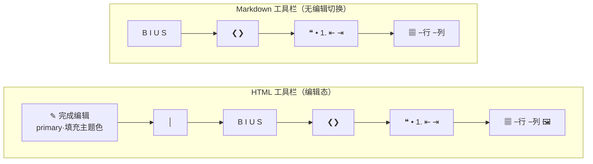

# 预览栏工具栏（Markdown / HTML 所见即所得）视觉重设计规格

> 版本：v0.4.1 ｜ 角色：产品经理 / UX+视觉 ｜ 状态：设计稿（仅规格，未改业务代码）
> 配套实现文件（待开发）：`src/features/workspace/components/Toolbar.tsx`、`ToolbarButton.tsx`
> 本文结论先行，结构：**现状问题 → 设计目标 → 具体规格 → 落地清单 → 待确认**。

---

## 0. 结论先行（TL;DR）

用户吐槽「太丑」的根因不是配色脏，而是**三件事**：(1) 工具栏没有自己的表面，直接透出暗色预览背景 `#181818`，形成一条沉重的「深棕/近黑」横条；(2) 14–16 个 24×24 原生按钮、图标用 lucide 默认 24px（零内边距）挤在一起，仅用 1px 细竖线分组，毫无层级；(3) 唯一的文字主操作「编辑/完成编辑」与图标组风格割裂，用色靠「红圈标注」才被注意到（红圈是用户标注，非原生样式）。

**重设计方向**：给工具栏一个克制、跟随应用主题语义变量的「chrome 表面」；把图标统一为一致的线性语言、固定 16px 图标 + 32px 按钮、用「留白 + 短分隔」取代粗竖线；把主操作做成有层级的强调按钮（用主题色 `--settings-accent` 替代红字）；抽一个共享 `Toolbar` + `ToolbarButton` 组件，根治 MD / HTML 两套样式漂移。全部颜色基于现有 CSS 变量，亮/暗双主题通用。

> 截图说明：4 张截图均为**暗色主题**。工具栏背景的「深棕」即 `--background: #181818`（暗色）的透出；图标为 `var(--foreground)` 的灰色线性描边；「编辑」按钮文字为浅色，其外红色矩形是用户自己的圈注（非原生红色文字）。当前代码里编辑按钮无任何红/填充样式（见 `html-wysiwyg.tsx:399` 的 `.alwith-wysiwyg-mode` 仅设字号/内边距/间距）。

---

## 1. 现状问题（已核对代码 + 截图）

### 1.1 当前实现清单（代码为唯一真源）

| 项 | 位置 | 现状 |
|---|---|---|
| MD 工具栏根节点 | `markdown-wysiwyg.tsx:264`（`MarkdownToolbar`，250–290） | `role="toolbar"` + `.alwith-wysiwyg-toolbar` |
| MD 按钮定义 | `markdown-wysiwyg.tsx:176–193`（`buttonSpecs`） | **14 个纯图标按钮，无「编辑切换」** |
| MD 按钮渲染 | `markdown-wysiwyg.tsx:268–285` | 手写 `<button class="alwith-markdown-action">`，图标 `<Bold/>` 等无 size |
| HTML 工具栏根节点 | `html-wysiwyg.tsx:396`（`HtmlToolbar`，194–432） | 同 `.alwith-wysiwyg-toolbar` |
| HTML 编辑切换按钮 | `html-wysiwyg.tsx:397–408` | `class="alwith-markdown-action alwith-wysiwyg-mode"`，`Pencil`/`Check` + 文字 |
| HTML 按钮定义 | `html-wysiwyg.tsx:443–461` | **15 个格式按钮（含 `deleteImage`）+ 1 个编辑切换 = 16** |
| 工具栏 CSS | `index.css:749–785` | `.alwith-wysiwyg-toolbar` 无背景、仅 `border-bottom`；`gap:2px; padding:4px 12px` |
| 按钮基础样式（包内） | `node_modules/@alwith/module-editor/dist/previews/markdown.css:14–36` | `24×24`、`background:transparent`、`color:var(--foreground)`、`hover→var(--accent)` |
| 预览头部按钮（参照系） | `preview-surface.tsx:99–133` | Base UI `Button` `variant="ghost" size="icon-sm"`（32px，16px 图标） |

> ⚠️ **与用户描述的两处出入（重要）**
> - 用户称「MD 含『编辑切换』」：当前代码 MD 工具栏**没有**编辑切换按钮（见上表）。用户截图里带「编辑」文字的是 **HTML 预览**（`html-wysiwyg.tsx:406–407`）。
> - 用户称 HTML 含「撤销」：当前代码**无**常驻撤销按钮，撤销仅在 `deleteRow/deleteColumn/deleteImage` 后通过 toast（`html-wysiwyg.tsx:378–387`）提供。
> 这两点已列入 §6 待确认。

### 1.2 视觉痛点（对应截图吐槽）

1. **无刻意表面，透出暗背景** → 一条沉重「深棕/近黑」横条，不像应用 chrome，更像一块临时拼贴。
2. **图标缺乏层次**：所有按钮同色（灰描边）、同尺寸、零内边距（24px 图标塞 24px 按钮），拥挤；分组仅靠 1px×16px 细竖线（`.alwith-wysiwyg-separator`），显陈旧。
3. **主操作割裂**：「编辑」是唯一文字按钮，与图标组语言不统一，且未用任何强调色，靠红圈才被注意。
4. **两套实现漂移**：MD（`markdown-wysiwyg.tsx`）与 HTML（`html-wysiwyg.tsx`）各自手写按钮渲染，类名/间距/激活态极易分叉。
5. **激活态过重且中性**：`[aria-pressed=true]` 直接 `var(--accent)` 实心灰块（`index.css:769`），在暗色里与背景区分弱、在亮色里发白，层级不清。

---

## 2. 设计目标

1. **现代、克制，与整窗风格统一**：复用应用既有的 Base UI `Button` 视觉语言（ghost / outline / default、32px `icon-sm`、16px 图标、focus ring），让工具栏像「预览头部按钮」的延伸。
2. **建立层级（主操作 vs 次级）**：唯一带文字的「编辑/完成编辑」是主操作，用主题色强调；其余格式/结构/表格为次级图标按钮。
3. **编辑态 vs 非编辑态清晰区分**：非编辑态工具栏「安静」（图标禁用/弱化），进入编辑态后格式按钮可用、且「完成编辑」以填充强调色明示「正在编辑」。
4. **双主题 + 主题色通用**：所有颜色走 `--background/--foreground/--muted/--border/--accent/--settings-accent` 等语义变量，暗色（当前主导）与亮色都正确，并跟随「主题色」预设。
5. **一套组件服务两套工具栏**：抽 `Toolbar` + `ToolbarButton`，MD/HTML 仅传按钮清单，杜绝样式漂移。

---

## 3. 具体规格

### 3.1 设计原则

- **表面即层级**：工具栏是一条有意为之的 chrome 条，而非透出背景。
- **图标语言统一**：全部 lucide 线性图标，`strokeWidth` 一致（默认 2，必要时 1.75），`currentColor` 着色；**激活态用「底色高亮」而非「面性图标」**，避免线性/面性混用。
- **分组用留白 + 短分隔**：去掉贯穿的粗竖线，改为组间留白 + 仅必要时一根更短、更低对比的分隔线。
- **主操作唯一强调**：仅「编辑/完成编辑」使用主题色（`--settings-accent`），全窗统一（呼应侧栏选中项、徽标等已用该体系的做法）。

### 3.2 布局与间距

| 令牌 | 值（建议） | 说明 |
|---|---|---|
| 工具栏高度 | `min-height: 44px` | 32px 按钮 + 上下各 6px |
| 工具栏内边距 | `padding: 6px 12px` | 横向 12px 与预览头部对齐 |
| 按钮尺寸 | **32×32px**（对齐头部 `icon-sm`） | 取代当前 24×24 |
| 图标尺寸 | **16px**（`size-4`） | 取代当前 24px（零内边距→拥挤根因） |
| 组内按钮间距 | `gap: 2px` | 维持紧凑 |
| 组间间距 | `margin-inline: 8px` 或 短分隔 | 取代 1px 粗竖线 |
| 分隔线 | 高 14px、`background: color-mix(in oklab, var(--border) 65%, transparent)`、`margin: 0 6px` | 比当前 16px/满 border 更轻 |
| 编辑按钮 | 自适应宽、`padding: 0 10px`、`gap: 6px`、图标 16px + 文字 12–13px | 取代当前 `padding:0 8px; font-size:12px` |

```
ASCII 示意（HTML 工具栏；MD 去掉「编辑」按钮即为同构）：
┌──────────────────────────────────────────────────────────────────────────┐
│ [✎ 编辑] │ [B][I][U][S]   [</>[❮❯]   [❝][•][1.][⇤][⇥]   [▦][−行][−列][🖼] │
│ 主操作     格式组      代码组      结构组          表格/图片组                │
│  ← 短分隔 →  ← 留白8 →  ← 留白8 →   ← 留白8 →     ← 留白8 →                │
└──────────────────────────────────────────────────────────────────────────┘
  表面: var(--muted) + 1px bottom border(var(--border))
  图标: 16px 线性 / 按钮 32px / 组间留白 8px / 仅主操作后用一根短分隔
```

### 3.3 配色（全部基于应用主题变量）

| 区域 | 暗色（`.dark`）值 | 亮色（`:root`）值 | 变量 / 备注 |
|---|---|---|---|
| 工具栏表面 | `oklch(0.269 0 0)` | `oklch(0.97 0 0)` | **`var(--muted)`** + `border-bottom: 1px solid var(--border)` |
| 按钮常态 | 透明底 + `oklch(0.985)` 图标 | 透明底 + `oklch(0.145)` 图标 | `background:transparent; color:var(--foreground)` |
| 按钮 hover | 8% 前景叠加（沿用应用全局 chrome hover） | 同 | `color-mix(in oklab, currentColor 8%, transparent)`（应用已对 `button:hover` 全局生效，`index.css:534–552`） |
| 按钮 active（格式已应用） | 中性高亮 + 反白字 | 中性高亮 + 深色字 | `background: var(--accent); color: var(--accent-foreground)`（保留现有 token，中性不抢戏） |
| 按钮 disabled | `opacity: 0.4; cursor:not-allowed` | 同 | 维持现状并显式 `pointer-events:none` |
| 主操作·非编辑态 | 描边/幽灵 + 主题色文字 | 同 | `outline` 变体、`color: var(--settings-accent-ink)`（暗）/ `--settings-accent`（亮） |
| 主操作·编辑中 | **填充主题色** + 反白字 | 同 | `background: var(--settings-accent); color: var(--settings-accent-ink)`（暗）/ 自动反白（亮）；作为「正在编辑」强信号 |
| focus-visible | `outline:2px solid var(--ring); outline-offset:2px` | 同 | 保留 `markdown.css:32–35`，并与 Base UI `ring-3 ring-ring/50` 对齐 |

> 用 `--settings-accent`（默认 YUP 红，可切换 sky-blue / emerald / lemon-green / girly-pink / warm-brown / linen-gray）替代原来的「红字」，使主操作色与整窗主题色体系一致；低彩度主题（linen-gray）下因应用已有暗色 `--accent-surface` 强度补偿（`index.css:1118–1130`），强调仍可见。

### 3.4 图标规范

- **风格统一**：lucide 线性图标，`strokeWidth=2`，`currentColor` 着色；不混用面性图标。
- **尺寸**：16px（`size-4`）；按钮 32px，图标居中、四周留白充足（解决拥挤）。
- **分组归属**（两套工具栏统一）：

  | 组 | 按钮（命令） | 备注 |
  |---|---|---|
  | 格式组 | `bold` `italic` `underline` `strike` | 行内格式 |
  | 代码组 | `inlineCode` `codeBlock` | `inlineCode` 前设分隔 |
  | 结构组 | `blockquote` `bulletList` `orderedList` `outdent` `indent` | `blockquote` 前设分隔 |
  | 表格组 | `insertTable` `deleteRow` `deleteColumn` | `insertTable` 前设分隔 |
  | 图片组（HTML 仅） | `deleteImage` | `requires: hasImage`，前设分隔 |
  | 编辑控制组 | `editHtml`/`finishEditHtml`（HTML 仅） | 主操作，文字+图标 |

- **激活态标识**：`aria-pressed=true` → 中性 `--accent` 底色高亮（非面性图标），一眼可辨「该格式已应用」。

### 3.5 状态设计（可访问性）

| 状态 | 表现 | 实现要点 |
|---|---|---|
| default | 透明底、前景色图标 | — |
| hover | 8% 前景叠加（与应用 chrome 一致） | 沿用全局 `button:hover` 规则 |
| active（格式已开） | `--accent` 底色 + 反白字 | `[aria-pressed="true"]` |
| disabled（编辑态外/无表格/无图片） | `opacity:.4` + `not-allowed` + `pointer-events:none` | 当前逻辑保留（`disabled={...}` 已在两处组件计算） |
| focus-visible | `2px var(--ring)` 环、`offset:2px` | 键盘可达，保留并统一到 Base UI ring |
| 编辑中（HTML） | 主操作转填充强调色 | 由 `editing` 状态驱动 |

> 可访问性：所有按钮已有 `title`/`aria-label`/`aria-pressed`； redesign 不移除任一属性。建议补充 `role="toolbar"` 上的 `aria-orientation="horizontal"`（现有 `<div role="toolbar">` 已具备）。

### 3.6 两套工具栏统一组件（根治漂移）

```
src/features/workspace/components/
├── Toolbar.tsx        // <div role="toolbar" className="alwith-wysiwyg-toolbar"> + 分组/分隔编排
└── ToolbarButton.tsx  // <button className="alwith-markdown-action alwith-toolbar-btn" ...>
                        //   统一 size/icon/aria-pressed/disabled/focus
```

- `ToolbarButton` 接收：`icon`、`label?`（有 label 即主操作/宽按钮）、`pressed?`、`disabled?`、`onClick`、`title`、`variant?`（'icon' | 'primary'）。
- `Toolbar` 接收：按钮规格数组（沿用现有 `ToolbarButtonSpec` 结构：`command/label/icon/pressed/requires/separator`），按 `separator` 插入短分隔，按组渲染。
- MD/HTML 两处组件只负责**业务逻辑**（编辑态、消息协议、`disabled` 计算），按钮的**视觉**全部交给 `Toolbar`/`ToolbarButton`，确保间距、尺寸、配色、激活态永不漂移。
- **测试兼容**：现有测试按 `.alwith-wysiwyg-toolbar`（存在性）与 `closest('.alwith-wysiwyg-toolbar')` 过滤按钮（`markdown-wysiwyg.test.tsx:140,297`）。因此 **保留 `.alwith-wysiwyg-toolbar` 根类与 `.alwith-markdown-action` 按钮类作为结构/测试钩子**，新增视觉类（如 `alwith-toolbar-btn`）叠加其上，不破坏现有断言。

### 3.7 示意图（Mermaid）



---

## 4. 落地清单（文件 : 行 + 建议组件）

### 4.1 新增组件（建议路径）
- `src/features/workspace/components/Toolbar.tsx` —— 工具栏容器 + 分组/短分隔编排。
- `src/features/workspace/components/ToolbarButton.tsx` —— 统一按钮（图标 16px、32px 尺寸、aria/focus/disabled、主操作 `primary` 变体）。

### 4.2 改 `markdown-wysiwyg.tsx`
- `:264` 根 `<div role="toolbar" className="alwith-wysiwyg-toolbar">` → 改用 `<Toolbar>`（传入 `buttonSpecs(labels)`），保留 `aria-label="Markdown formatting"`。
- `:268–285` 手写 `<button …>{spec.icon}</button>` → 改为 `<ToolbarButton spec={spec} state={state} disabled={disabled} onActivate={…} />`。
- `:176–193` `buttonSpecs` 可原样复用（已是纯数据），仅补充 `group` 字段用于分组。

### 4.3 改 `html-wysiwyg.tsx`
- `:397–408` 编辑切换按钮 → 改为 `<ToolbarButton variant="primary" icon={editing?<Check/>:<Pencil/>} label={…} pressed={editing} disabled={blocked && !editing} onClick={…} />`（主操作变体，编辑中填充主题色）。
- `:409` 分隔 `<span class="alwith-wysiwyg-separator">` → 由 `<Toolbar>` 的组渲染接管（短分隔）。
- `:410–429` 格式按钮 map → 同 MD，改用 `<ToolbarButton>`。
- `:443–461` `buttonSpecs` 增加 `group` 字段（含 `deleteImage` 的 `image` 组）。

### 4.4 改 `index.css`（重写工具栏视觉，scope 在 `.alwith-wysiwyg-toolbar` 内以覆盖包内 `markdown.css` 默认值）
- `:753–768` `.alwith-wysiwyg-toolbar`：加 `min-height:44px; padding:6px 12px; background:var(--muted); border-bottom:1px solid var(--border)`；重写 `.alwith-wysiwyg-separator` 为更短/更低对比（高 14px、`color-mix(var(--border) 65%, transparent)`、`margin:0 6px`）。
- `:769–772` `[aria-pressed="true"]`：保留 `var(--accent)` 中性高亮（或微调为 12–16% tint）。
- `:773–778` `:disabled`：加 `pointer-events:none`。
- `:780–785` `.alwith-wysiwyg-mode`：删除或改为 `ToolbarButton` 的 `primary` 变体样式（见 3.3 主操作配色）。
- **新增** `.alwith-wysiwyg-toolbar .alwith-markdown-action`（按钮尺寸/图标）：`width:32px; height:32px; border-radius:min(var(--radius-md),10px); color:var(--foreground)`；`svg{width:16px;height:16px}`（覆盖 lucide 默认 24px）。
- **新增** 主操作 `.alwith-wysiwyg-toolbar .alwith-toolbar-btn--primary`：非编辑态 outline + `var(--settings-accent-ink)`；编辑中 `background:var(--settings-accent); color:var(--settings-accent-ink)`（暗）/自动反白（亮）。

> ⚠️ **CSS 覆盖顺序**：按钮基础样式定义在包内 `node_modules/@alwith/module-editor/dist/previews/markdown.css:14–36`（透明底/24px/`hover→var(--accent)`）。宿主 `index.css` 已用 `.alwith-wysiwyg-toolbar .alwith-markdown-action` 作用域覆盖（`:769` 起）。落地时**保持该作用域写法**，并在 dev 中确认宿主样式胜出；若因打包顺序被包内样式覆盖，则对 `width/height/background(hover)` 提升特异性或加 `@layer` 编排。

### 4.5 不改
- 业务逻辑、`computeFormatState`、消息协议（`html-edit-protocol`）、`wysiwyg-types.ts` 的命令/状态契约 —— 本次纯视觉，行为零改动。

---

## 5. 验证（视觉回归口径，供 QA 参考）

1. 暗色 + 亮色各截一张 MD / HTML 工具栏，确认：表面为 `--muted` 浅/深灰条（非透出背景）、图标 16px 居中不拥挤、组间留白/短分隔清晰。
2. HTML：非编辑态「编辑」为描边/幽灵；点入编辑后「完成编辑」填充主题色；格式按钮可用、已应用格式有中性高亮、`focus-visible` 有环。
3. MD：14 个图标按钮分组正确，无编辑切换（如 §6 确认要加，则补对称按钮）。
4. 现有单测 `*.test.tsx`（`.alwith-wysiwyg-toolbar` 存在性、`closest` 过滤按钮数）不破——因保留 `.alwith-wysiwyg-toolbar` 与 `.alwith-markdown-action` 钩子。

---

## 6. 待确认事项（Open Questions）

1. **主题主导**：当前 4 张截图均为**暗色主题**（预览背景 `#181818`）。是否需为**亮色主题**单独微调工具栏表面（如亮色下 `--muted` 太浅、仅靠 border 区分）？建议双主题通用（已按变量设计），但请确认是否要把亮色也纳入本轮验收。
2. **MD 是否补「编辑切换」**：当前 MD 工具栏无编辑切换按钮（编辑态由 `readOnly` 隐式控制）。用户描述称 MD 含「编辑切换」——是否要在 MD 也加对称的编辑态切换（用同一 `ToolbarButton primary`），还是维持 MD 隐式编辑、仅 HTML 有切换？
3. **HTML 是否补常驻「撤销」**：当前撤销仅通过删除类操作的 toast 提供。是否要在 HTML 工具栏新增常驻「撤销」按钮（走 `HtmlHostUndoMessage`）？
4. **主操作强调色**：用 `--settings-accent`（跟随主题色，推荐，呼应整窗）还是 `--primary`？建议前者。
5. **激活态表现**：格式已应用的激活态用「中性 `--accent` 底色高亮」（推荐，风格统一）还是「主题色淡底 + 主题色字」？前者更克制。
6. **图标风格**：确认统一为 lucide 线性（`strokeWidth=2`）即可；是否接受 active 态用「底色高亮」而非「面性图标」？（推荐底色高亮，避免线性/面性混用。）
